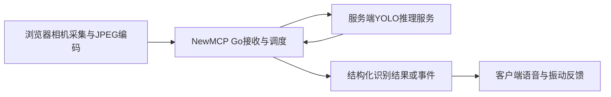

# 摄像头与 Agent 调用指南

更新：2026-10-02。本文包含当前可用接口，以及下一阶段 YOLO 识别、寻物与监控的调用约定。标为“拟新增”的字段、工具、事件和端点尚未实现，不能直接在当前服务上调用；接入前以 `tools/list`、`mcp.describe` 和 `events/list` 的实际结果为准。

## 1. 能力状态与首版范围

| 能力 | 当前状态 |
| --- | --- |
| 创建、启用摄像头，生成／撤销推流密钥 | 已实现 |
| 浏览器上传 JPEG，capture_frame 截图，analyze_frame 分析 | 已实现；当前上传间隔固定 2000ms |
| Events 的 poll、push、签名 webhook | 已实现；只支持 MCP 目录与资源变更 |
| 上传间隔后台配置为 1000ms 或其他值 | 拟新增 |
| detect_objects、类别／区域出现消失监控 | 拟新增 |
| 寻物方向提示、语音与振动 | 拟新增；客户端需要实现反馈能力 |
| 个人物品身份匹配、深度与行走障碍感知 | 后续阶段 |
| 独立导航与完整危险覆盖 | 后期研究范围 |

首版支持常见类别识别、站定扫描寻物和基础出现／消失事件。上传间隔可配置并不等于识别结果也按同样频率产生，客户端还要考虑推理耗时、积压和结果新鲜度。

兼容性硬性要求：YOLO 是可选能力。未配置、未启用或推理服务不可用时，NewMCP 启动、现有摄像头推流、capture_frame、基于原 VisionConfig 的 analyze_frame，以及其他 MCP 工具和现有事件功能都必须保持可用。下述方案与验收以这一要求为前提。

## 2. 三种凭证与职责

| 凭证 | 用途 | 获取与使用 |
| --- | --- | --- |
| 登录 JWT | 摄像头管理 REST API | 登录取得，在 Authorization: Bearer 中提供 |
| 摄像头 stream_key | 单路摄像头上传画面 | 属主生成；推流 URL 使用 `?k=`；不是 JWT 或 MCP API Key |
| MCP API Key | 发现、调用摄像头工具，订阅授权事件 | API Key 绑定包含摄像头服务的分组；HTTP 使用 X-API-Key |

NewMCP 摄像头页／采集客户端负责获取本机相机权限并上传画面。MCP 连接本身不会打开手机摄像头。Agent 负责理解目标与调用工具，事件接收模块负责消费事件并启动或恢复 Agent，语音和振动由客户端执行。

首版 YOLO 在服务端的独立推理服务中运行，不加载到摄像头浏览器，也不直接嵌入 Go 主程序。NewMCP 服务与 YOLO 服务可以部署在同一服务器的不同容器，也可以通过受控内部接口部署在不同机器。画面传输与识别路径为：



| 部署方式 | 首版选择与影响 |
| --- | --- |
| 服务端 YOLO | 首版采用；集中加载模型，浏览器上传画面，依赖网络和服务器算力 |
| 浏览器 YOLO | 后续可选；需要转换模型、浏览器推理运行时及性能／兼容性验证，不能直接在浏览器运行 Python ultralytics 包 |
| 手机原生／穿戴端 YOLO | 后续离线与较低延迟感知方向；需要专门客户端、设备适配与模型部署 |

服务端识别意味着图像会发送到配置的服务器／推理服务，界面应说明处理位置。浏览器端识别可设计为只上传摘要，但新方案需要明确哪些事件由客户端产生、如何鉴权与验证，以及如何统一服务端规则；不能直接沿用“服务器拿最新 JPEG 推理”的假设。行走时的紧迫提示后续优先评估本地感知路径。

## 3. 当前可用：创建、启用与推流

管理 API 前缀为 `/api/v1`。以下示例使用 Bash、curl、jq；所有凭证都是占位变量，不应写进共享代码或日志。

```bash
export NEWMCP_BASE='http://localhost:3000'
export NEWMCP_JWT='<登录 JWT>'

# 当前版本 vision_config_id 必填，且必须属于当前用户。
curl --silent --show-error "$NEWMCP_BASE/api/v1/cameras" \
  -H "Authorization: Bearer $NEWMCP_JWT" \
  -H 'Content-Type: application/json' \
  --data '{"name":"寻物摄像头","description":"手机后置镜头","vision_config_id":1}'

# 保存创建响应 data.id；示例用 12，实际应替换。
export CAMERA_ID='12'
curl --silent --show-error -X POST \
  "$NEWMCP_BASE/api/v1/cameras/$CAMERA_ID/enable" \
  -H "Authorization: Bearer $NEWMCP_JWT"

curl --silent --show-error \
  "$NEWMCP_BASE/api/v1/cameras/$CAMERA_ID/stream-key" \
  -H "Authorization: Bearer $NEWMCP_JWT"

# 没有密钥时生成；重新生成会立即断开旧推流连接。
curl --silent --show-error \
  "$NEWMCP_BASE/api/v1/cameras/$CAMERA_ID/stream-key" \
  -H "Authorization: Bearer $NEWMCP_JWT" \
  -H 'Content-Type: application/json' \
  --data '{"expires_in":3600}'
```

密钥接口返回 `data.stream_key`、`data.stream_url`、`data.expires_at` 和 `data.has_key`。优先打开返回的 stream_url，并在页面上主动开启摄像头；URL 形如 `/camera-live/12?k=<stream_key>`。手机访问需要可达地址和浏览器允许的安全上下文。`localhost` 示例只用于本机。

自研采集器连接 `wss://<服务器>/api/v1/cameras/12/stream?k=<stream_key>`，上传原始 JPEG 二进制消息。每路同时只接受一个推流连接。停止或撤销密钥后，应清理客户端相机、编码和发送任务。

当前服务端只缓存最新帧，断开后清理缓存；没有历史录像。当前 CapturedAt 是服务端收到帧的时间。现有 capture_frame／analyze_frame 尚无严格的帧年龄校验，客户端不能据此假设画面一定足够新鲜。

## 4. 当前可用：MCP 工具调用

先将启用后创建的 `camera_12` 服务加入分组，再给 MCP API Key 授权该分组。服务名以摄像头 ID 自动生成，不是用户填写的摄像头显示名称。

Direct 模式从 tools/list 取得 `camera_12__capture_frame`；Smart 模式先 search／describe，再以 `camera_12.capture_frame` 作为 mcp.execute 的 tool_id。不要根据显示名称猜工具 ID。

下列函数使用当前项目支持的 `2026-07-28` 请求格式，每次请求携带协议元数据，并在 HTTP 头镜像方法、协议版本及工具名称。若后续升级协议，应以 server/discover 与项目协议文档为准。

```bash
export MCP_URL="$NEWMCP_BASE/mcp"
export MCP_API_KEY='<已授权摄像头分组的 API Key>'

mcp_rpc() {
  local mcp_method="$1" mcp_params="$2"
  local -a name_headers=()
  if [ -n "${3:-}" ]; then
    name_headers=(-H "Mcp-Name: $3")
  fi
  curl --no-buffer --silent --show-error "$MCP_URL" \
    -H "X-API-Key: $MCP_API_KEY" \
    -H 'Content-Type: application/json' \
    -H 'Accept: application/json, text/event-stream' \
    -H 'MCP-Protocol-Version: 2026-07-28' \
    -H "Mcp-Method: $mcp_method" \
    "${name_headers[@]}" \
    --data "$(jq -cn --arg method "$mcp_method" --argjson params "$mcp_params" '
      {jsonrpc:"2.0",id:1,method:$method,params:($params + {
        _meta:{
          "io.modelcontextprotocol/protocolVersion":"2026-07-28",
          "io.modelcontextprotocol/clientCapabilities":{extensions:{"io.newmcp/events":{}}},
          "io.modelcontextprotocol/clientInfo":{name:"camera-agent-example",version:"1"}
        }
      })}')"
}

mcp_rpc server/discover '{}'
mcp_rpc tools/list '{}'
mcp_rpc tools/call \
  '{"name":"camera_12__capture_frame","arguments":{}}' \
  'camera_12__capture_frame'
mcp_rpc tools/call \
  '{"name":"camera_12__analyze_frame","arguments":{"prompt":"描述当前画面中可见的物品及其画面位置。"}}' \
  'camera_12__analyze_frame'
```

capture_frame 返回 `content` 中的 image 与截图时间文本；analyze_frame 返回视觉模型的文本分析。两者是按需单帧工具，不自动创建持续监控。

Smart 模式示例：

```bash
export MCP_URL="$NEWMCP_BASE/smart/mcp"
mcp_rpc tools/call \
  '{"name":"mcp.search","arguments":{"query":"摄像头 camera capture analyze"}}' 'mcp.search'
mcp_rpc tools/call \
  '{"name":"mcp.describe","arguments":{"targets":["camera_12.capture_frame"],"include_schema":true}}' 'mcp.describe'
mcp_rpc tools/call \
  '{"name":"mcp.execute","arguments":{"tool_id":"camera_12.capture_frame","arguments":{}}}' 'mcp.execute'
```

后续示例切回 Direct `/mcp`。新工具也采用同样的命名规则，Smart 调用者通过 mcp.execute 执行，业务事件订阅则调用 events/* 方法。

## 5. 拟新增：后台采集与识别配置

配置入口在 NewMCP 后台，浏览器采集页不直接配置或访问 YOLO 服务。NewMCP 保存推理服务地址、访问凭证、模型选择和每路摄像头的采集／识别参数，由 Go 后端调用推理服务；浏览器只接收采集间隔和分辨率等必要控制信息，不接收 detection_endpoint 或 detection_api_key。

YOLO 服务需先独立部署，权重安装／加载、CPU／GPU、推理运行环境和支持的模型清单由该服务的部署配置管理。NewMCP 的 detection_model 只能选择推理服务已经支持的模型，不代表自动下载或安装权重。首版连接字段保存在摄像头配置中；后续可提取为可复用的推理服务配置，供多路摄像头选择。

沿用 POST／PUT `/api/v1/cameras` 管理配置，拟增加以下字段；当前版本不会按这些字段控制采集，客户端必须等待能力上线后使用。

| 字段 | 类型／拟议默认值 | 约束与语义 |
| --- | --- | --- |
| capture_interval_ms | integer / 2000 | 100–60000；保留原有两秒一帧，后台显式改为 1000 或其他值后才改变频率 |
| detection_enabled | boolean / false | 开启后台 YOLO 识别；不代替摄像头启用与采集 |
| detection_endpoint | string / empty | YOLO 未启用时可留空；启用时必须填写完整的内部推理服务 /detect URL |
| detection_model | string / yolo26n | 按服务实际支持的模型白名单校验 |
| detection_confidence | number / 0.5 | 0.01–1；为类别过滤分数，不表示道路安全概率 |
| detection_api_key | string / empty | 可选内部服务凭证；只写入，不从详情接口返回原文 |
| has_detection_api_key | boolean / read-only | 详情显示是否已保存凭证 |
| vision_config_id | integer / optional | 拟允许纯 YOLO 摄像头省略；更新为 0 表示解绑视觉模型 |

### 5.1 可选依赖与故障隔离

以下是拟实现的兼容性约定，不代表当前已有 YOLO 故障处理：

| 情况 | 原有功能 | 新增识别／监控行为 |
| --- | --- | --- |
| 未填写 YOLO 配置 | 按原路径运行 | 不启动检测任务、不向推理服务发送画面；请求识别／运行监控时明确提示未配置 |
| 已保存配置但 detection_enabled=false | 按原路径运行 | 不推理；停止已有检测任务，暂停规则，不产生物品消失事件 |
| 已启用且配置有效 | 按原路径运行 | 异步推理并推进监控状态 |
| 推理服务拒连、超时、鉴权失败或响应无效 | 按原路径运行 | 仅检测进入异常状态，有限重试并退避，暂停规则确认；恢复后重建基线 |

NewMCP 启动及就绪检查不能以 YOLO 连通性为前置条件。原有构建镜像和默认部署不增加 Python／PyTorch、模型权重或强制 YOLO 容器依赖；独立服务由需要该能力的部署显式启动。未配置时不自动下载模型，不探测默认／空端点。

capture_frame 继续从现有最新帧缓存读取，analyze_frame 继续调用绑定的 VisionConfig；两者不能先检查 YOLO 配置或等待 YOLO 初始化。原工具名称、参数 Schema、返回 content、鉴权和推流密钥语义保持兼容。新识别操作的未配置／未启用／推理异常应有可区分的错误，不能用 objects=[] 代替；有效新鲜帧确实没有匹配目标时才返回空数组。

旧摄像头迁移时 detection_enabled=false，端点和凭证为空，保留原 VisionConfig、服务 ID、密钥、分组权限与已有描述；上传间隔保留 2000ms。创建／更新请求省略 YOLO 字段仍有效，更新中省略字段不得清空原配置；仅在请求明确启用检测时要求必要的 YOLO 配置。解绑 VisionConfig 必须显式操作，不能因添加 YOLO 自动解绑或替换。

推理通过独立后台调度执行，使用有限超时、并发上限和最新帧优先；不在 WebSocket 收帧循环或帧缓存锁内等待推理。YOLO 故障、重试和慢请求不能阻塞收帧、原工具调用或其他摄像头。旧采集器仍可发送原始 JPEG 二进制消息；新增采集控制信息需向后兼容，未配置新采集参数时保留原有频率与画面参数。

### 5.2 配置示例与控制消息

拟议更新示例：

```json
{
  "capture_interval_ms": 1000,
  "detection_enabled": true,
  "detection_endpoint": "http://yolo:8000/detect",
  "detection_model": "yolo26n",
  "detection_confidence": 0.5
}
```

拟由服务端在推流 WebSocket 连接后以及配置变化时发送文本控制消息，客户端执行配置，采集循环使用最新间隔；已有 JPEG 二进制消息形式继续保留：

```json
{"type":"config","capture_interval_ms":1000,"resolution_w":640,"resolution_h":480}
```

客户端缩放时保持画面比例，编码不重叠，发送缓冲积压时丢弃待发送旧帧。服务端每路仅调度最新帧，同一帧不重复推进监控状态。较高采样率可能仍被推理速度限制，应在界面分别展示采集间隔、结果帧时间与健康状态。

## 6. 拟新增：识别与监控工具

| 工具 | 参数 | 作用 |
| --- | --- | --- |
| detect_objects | classes?、min_confidence?、max_age_ms? | 查询或触发当前帧识别；返回结构化结果 |
| create_monitor | label、name?、region?、event?、confirm_ms?、absence_ms?、cooldown_ms?、emit_initial? | 创建持续规则，返回 monitor ID |
| list_monitors | 空对象 | 查询当前摄像头的规则与状态 |
| update_monitor | monitor_id、enabled | 启停规则；首版只支持此更新 |
| delete_monitor | monitor_id | 删除规则；先取消事件订阅，再删除 |

类别用实际模型支持的名称，例如 cup、cell phone；常见中文可映射到规范名称。不支持的目标返回明确错误，不能悄悄返回“没有目标”。region 是 `[x1,y1,x2,y2]` 的归一化矩形，原点在原图左上角，范围 0–1，按目标框中心是否落入区域判断。画面方位以未镜像的原始相机图为准。

拟议去抖默认值：confirm_ms=1000、absence_ms=3000、cooldown_ms=3000；event 为 appeared、disappeared 或 both，默认 both。emit_initial 默认为 false，先建立存在／缺席基线；寻物会话可以设为 true，让首次确认目标存在也产生 appeared。只有持续成功且足够新的不同帧累积证据，间断／错误会中止候选确认。提高上传间隔时，确认时延也会增加。

拟议 detect_objects 调用：

```bash
export MCP_URL="$NEWMCP_BASE/mcp"
mcp_rpc tools/call \
  '{"name":"camera_12__detect_objects","arguments":{"classes":["cup"],"min_confidence":0.5,"max_age_ms":3000}}' \
  'camera_12__detect_objects'
```

拟议 `result.structuredContent` 成功数据如下，同时应在 content 中保留可读文本，便于现有 Agent 客户端兼容：

```json
{
  "camera_id": 12,
  "frame_id": "frame_1842",
  "captured_at": "2026-10-02T09:30:00+08:00",
  "age_ms": 180,
  "status": "ready",
  "cached": true,
  "model": "yolo26n",
  "frame_size": {"width": 640, "height": 480},
  "objects": [
    {"label":"cup","class_id":41,"confidence":0.91,"bbox_xyxy":[120,180,230,340],"position":"left"}
  ]
}
```

captured_at 在首版明确表示服务端收帧时间，不冒充相机曝光时间；bbox_xyxy 是对应 frame_size 的像素坐标。position 仅表示画面左／中／右；没有深度与姿态校准时不报告米数或人体相对方位。缓存结果也必须满足 max_age_ms；有效新鲜帧未检测到目标时 objects=[]，离线、旧帧或推理失败则返回错误／异常状态。

拟议创建“杯子离开桌面区域”规则：

```bash
mcp_rpc tools/call \
  '{"name":"camera_12__create_monitor","arguments":{"label":"cup","name":"桌面杯子","region":[0.1,0.3,0.9,0.95],"event":"disappeared","confirm_ms":1000,"absence_ms":5000,"cooldown_ms":3000,"emit_initial":false}}' \
  'camera_12__create_monitor'
```

客户端保存返回的 monitor ID，例如 mon_abc。规则属于该摄像头和当前用户；确认“持续未检测到”不表示确定被拿走。采集断开／推理失败时应产生健康状态变化，不能产生 disappeared。

拟议 REST 管理入口与 MCP 操作共用规则引擎，使用登录 JWT：GET `/cameras/:id/detections`，GET／POST `/cameras/:id/monitors`，PUT／DELETE `/cameras/:id/monitors/:monitorId`。这些端点当前尚未注册；摄像头推流密钥不能调用它们。

## 7. 拟新增：摄像头事件订阅

当前 events/list 只有四种 MCP 目录／资源事件。以下两个事件需要新的本地摄像头事件源、目录 Schema 和权限实现，不能通过订阅现有 mcp.resources.updated 自动获得。

| 事件 | 含义 | arguments |
| --- | --- | --- |
| camera.monitor.triggered | 规则确认 appeared／disappeared | 必填字符串 service、monitor_id |
| camera.monitor.status_changed | 初始化、离线、推理异常、恢复、暂停 | 必填字符串 service、monitor_id |

订阅仅使用字符串 ID，区域、目标和阈值放在持久化规则中。摄像头规则不会因单个订阅到期而删除，也不应为不同订阅者分别运行 YOLO。授权按摄像头属主、API Key 分组／服务范围和规则归属检查，不能因为 virtual 服务就跳过检查；自有服务策略应与现有摄像头工具保持一致。每次回放和 webhook 重试都重新验证权限。

以下示例使用第 4 节的 mcp_rpc 函数。现代请求要显式声明 io.newmcp/events 扩展；该函数已经添加。先创建规则，再订阅，最后开启采集，避免目标在订阅建立前就触发。已在采集时创建规则，需先建立事件接收，再查询一次当前状态，补齐建立订阅期间的观测缺口。

```bash
mcp_rpc events/list '{}'

# 独立终端打开持续流，按 Ctrl+C 取消。
mcp_rpc events/stream \
  '{"name":"camera.monitor.triggered","arguments":{"service":"camera_12","monitor_id":"mon_abc"},"cursor":null}'

# poll 无需先 subscribe；保存 result.cursor，下次原样带回。
mcp_rpc events/poll \
  '{"name":"camera.monitor.triggered","arguments":{"service":"camera_12","monitor_id":"mon_abc"},"cursor":null,"maxEvents":50}'
```

拟议事件载荷：

```json
{
  "eventId": "evt_example",
  "name": "camera.monitor.triggered",
  "timestamp": "2026-10-02T09:30:05+08:00",
  "data": {
    "service": "camera_12",
    "camera_id": 12,
    "monitor_id": "mon_abc",
    "label": "cup",
    "trigger": "disappeared",
    "state": "absent",
    "frame_id": "frame_1847",
    "captured_at": "2026-10-02T09:30:05+08:00",
    "last_detected_at": "2026-10-02T09:30:00+08:00"
  },
  "cursor": "opaque_cursor"
}
```

事件使用稳定业务 ID，接收端按 eventId 去重。cursor 是每个身份、事件与参数范围的回放位置，不是业务序号，不能跨 API Key、监控规则或事件类型混用。身份还包括用户、分组端点和 Direct／Smart 模式；同一个 API Key 也不能跨 `/mcp`、`/smart/mcp` 或不同分组端点混用 cursor、续订和取消请求。目标进入 ROI／离开 ROI 与出现／消失不是同一语义；首版规则表达的是区域内持续检测到／未检测到目标。

## 8. Webhook 注册、验签、续期与取消

投递机制是当前已有能力，但本节摄像头事件名称是拟新增。回调必须为公网 HTTPS；localhost、内网地址和重定向目标不支持。手机客户端通常使用 events/stream，webhook 交给后台接收服务。

```bash
export MCP_CALLBACK_URL='https://receiver.example.com/hooks/camera'
export MCP_WEBHOOK_SECRET="whsec_$(openssl rand -base64 32)"

mcp_rpc events/subscribe "$(jq -cn \
  --arg url "$MCP_CALLBACK_URL" --arg secret "$MCP_WEBHOOK_SECRET" '
  {name:"camera.monitor.triggered",arguments:{service:"camera_12",monitor_id:"mon_abc"},
   delivery:{mode:"webhook",url:$url,secret:$secret},cursor:null,ttlMs:300000}')"

# 在响应 refreshBefore 到期前续期，保持端点、name、arguments、URL 相同。
# 活跃订阅保留自身投递水位，续期无需提交 cursor。
mcp_rpc events/subscribe "$(jq -cn \
  --arg url "$MCP_CALLBACK_URL" --arg secret "$MCP_WEBHOOK_SECRET" \
  '
  {name:"camera.monitor.triggered",arguments:{service:"camera_12",monitor_id:"mon_abc"},
   delivery:{mode:"webhook",url:$url,secret:$secret},ttlMs:300000}')"

# 订阅过期后重建时才提交保存的同范围水位，并按 eventId 去重。
export MCP_EVENT_CURSOR='<同一订阅范围保存的 cursor>'
mcp_rpc events/subscribe "$(jq -cn \
  --arg url "$MCP_CALLBACK_URL" --arg secret "$MCP_WEBHOOK_SECRET" \
  --arg cursor "$MCP_EVENT_CURSOR" '
  {name:"camera.monitor.triggered",arguments:{service:"camera_12",monitor_id:"mon_abc"},
   delivery:{mode:"webhook",url:$url,secret:$secret},cursor:$cursor,ttlMs:300000}')"

# 取消使用原订阅键，不是仅提交响应里的 id。
mcp_rpc events/unsubscribe "$(jq -cn --arg url "$MCP_CALLBACK_URL" '
  {name:"camera.monitor.triggered",arguments:{service:"camera_12",monitor_id:"mon_abc"},
   delivery:{url:$url}}')"
```

接收端流程：

1. 保留 HTTP 原始 body，在解析 JSON 前校验 webhook-id、webhook-timestamp、webhook-signature；检查允许的时间窗口并使用恒定时间比较。
2. 签名内容为 `UTF8(id + "." + timestamp + ".") + rawBody`；secret 去掉 whsec_ 后 Base64 解码，计算 HMAC-SHA256。webhook-signature 包含空格分隔的一个或多个 `v1,<Base64>`；密钥轮换期间会双签 30 秒，应支持允许密钥的任一有效签名。不要用重新序列化的 JSON 验签。
3. 首次收到 `{type:"verification",challenge:"..."}` 时，验签后返回 2xx JSON `{challenge:"同一个值"}`，订阅才会激活。
4. 正常事件先保存或可靠排队、按 eventId 去重，再返回 2xx；Agent 处理可在响应后运行。重试中业务 eventId 稳定，签名时间戳会变化。
5. 分别处理 verification、gap、terminated 等控制消息；不要把它们当成物品事件。

当前 webhook 订阅 TTL 最多五分钟，响应 refreshBefore 是实际到期时间；按该值自动续期，不是固定睡五分钟。活跃订阅续期忽略请求 cursor，保留当前投递水位，应保存响应 result.cursor。事件载荷 cursor 指向本次事件之前的水位，重建时可能再次收到当前事件，必须去重。订阅与回放在内存中，进程重启后重建；有限重试不是永不丢失保证。持久化监控规则不等于持久化投递，后者需要后续事件日志与恢复机制。

## 9. 寻物客户端与停止流程

推荐先实现“用户站定，用后置相机扫描常见物品”：Agent 把“找杯子”转换为 label=cup，查询 detect_objects；需要持续发现时创建 event=appeared、emit_initial=true 的规则，建立订阅后启动采集。若多个 cup 同时出现，应询问或选择目标，不能自动声称其中一个就是用户的杯子。

客户端根据新鲜检测结果直接播报“当前画面左侧发现杯子”，目标居中时给短音或振动。只有方向或目标状态变化才更新反馈，避免每帧重复播报。摄像头镜像显示不改变原图位置语义；目标检测框不是手部可触及位置，也不是行走路线。

拟议推流结果消息为 `{"type":"detections","data":<第6节识别结果>}`。它只交给当前有密钥的推流连接，不开放其他摄像头或管理 API；实现时仍需确认这一凭证的读取范围。目标丢失、无新帧、相机遮挡或错误时停止方向指引并提示感知状态。客户端收到旧事件、旧会话结果或重连回放时，先检查帧／事件时效，不能将历史发现播报为当前位置。

停止顺序：取消 stream／webhook 订阅 → 关闭或删除监控规则 → 关闭相机采集和推流 → 取消未播放的语音与振动。取消订阅只停止通知，不能代替停止监控规则；关闭相机也不能代替取消后台订阅。

## 10. 排错与后续实施计划

| 现象 | 检查项 |
| --- | --- |
| WS 401 | 是否使用 k、密钥是否匹配／过期／撤销；不是 JWT |
| WS 403 | 摄像头是否启用 |
| WS 409 | 已有其他采集页面占用该摄像头 |
| capture_frame 无帧 | 用户是否开启相机、浏览器是否仍在采集、WS是否正常 |
| 工具不在 tools/list | 摄像头是否启用、服务是否加入分组、API Key 是否授权、条目是否被禁用 |
| analyze_frame 失败 | 绑定视觉配置、上游凭证／端点及调用超时 |
| 新工具／摄像头事件 Unknown | 该功能尚未上线；当前目录不包含拟新增能力 |
| events/* 返回 -32021 | 现代请求缺少 io.newmcp/events 客户端扩展声明 |
| webhook 注册失败 | 公网 HTTPS、secret 格式、challenge 回显与签名是否正确 |
| 五分钟后无通知 | 订阅是否按 refreshBefore 续期；规则运行与订阅分别检查 |
| 回放出现 gap／truncated | 重新查询当前规则与画面状态，保存新 cursor，不把缺口解释为没有事件 |

下一阶段按以下顺序实施，每阶段完成相应验证后再推进：

0. 兼容性基线：验证未配置／未启用 YOLO 时可启动，旧创建更新、推流、capture_frame、analyze_frame 和现有 Events 正常；检查无 YOLO 调用及权重下载、旧配置与工具契约未改变。
1. 配置与采集：上传间隔持久化，保留 2000ms 的默认值与旧数据迁移，WS 下发／热更新，显式采集配置、缩放与积压处理，解绑 VisionConfig 的兼容性。
2. YOLO 与查询：可选的独立常驻推理服务、模型白名单、检测超时、新鲜帧缓存、detect_objects；验证实际图像坐标、部署时延，以及拒连／超时／鉴权失败不阻塞原有功能。
3. 持续规则：规则持久化、区域与时间去抖、emit_initial、离线／恢复基线、删除与停机清理；测试重复帧不累积、断线不触发消失。
4. 摄像头事件：独立 virtual camera 权限解析、本地事件源、poll／push／webhook 对接；验证跨租户、撤权、续期、重试与回放缺口。
5. 寻物体验：原地扫描、画面方向、可控语音／振动、无障碍停止操作；邀请目标用户进行受控验证。个人物品登记、测距、障碍感知和独立导航分别列入后续阶段。

相关文档：[API](./API.md#8-摄像头接口)、[MCP 协议与事件](./MCP-PROTOCOL.md#11-订阅与实验-events)、[技术可行性调研](./YOLO-CAMERA-FEASIBILITY.md)。
