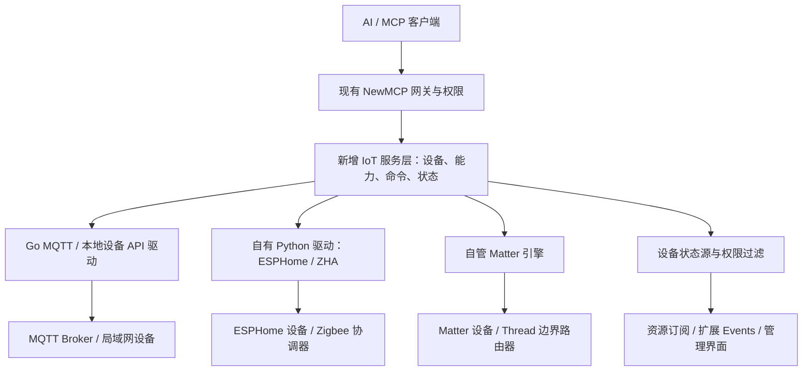

物联网原生扩展与 Home Assistant Core 集成可行性调研

调研日期：2026-10-27。当前项目基线：`999801733ab8cc62143411852152cd4184379881`。Home Assistant Core 以当日最新稳定版 `2026.10.4` 为主要源码依据，同时检查官方文档和独立协议库；独立库默认分支资料可能继续变化。[稳定版发布页](https://github.com/home-assistant/core/releases/tag/2026.10.4)。

本文是源码和文档层面的可行性评估，未安装 HA、未连接实际设备、未验证端到端兼容性。下述新增模块、接口、数据表和工具均为建议，不代表已实现。本次仅新增本调研文档。

**结论：可以复用 Home Assistant 生态，但“集成整个 Core”和“去除 HA 依赖”是两种不同的路线。**

- 如果目标是用户不用单独安装和维护 Home Assistant，可以由 NewMCP 配套部署 HA Container，统一管理配置与生命周期。技术上可行，运行时仍然依赖 HA。
- 如果目标是设备控制链路完全不经过 HA，应在 NewMCP 建立自己的设备管理层，直接调用 MQTT、设备 API 或独立协议库。推荐这条路线。
- 把 `home-assistant/core` 当作 Go SDK 直接导入，或者只复制 `homeassistant/components/` 就获得完整设备支持，均不是现成可用的方案。
- 去除 HA 不等于去除全部第三方开源库、MQTT Broker、无线协调器或 Thread Border Router。它们分别承担协议实现、消息传输和物理网络接入，需明确保留哪些依赖。

**当前项目具备的基础，以及真正缺失的部分**

| 本地证据 | 当前实际情况 | 对 IoT 扩展的意义 |
|---|---|---|
| `go.mod:3`、`README.zh_CN.md` | 后端 Go 1.26.2、Gin、GORM，前端 React/TypeScript | 保留现有平台，不适合整体改写成 Python 应用 |
| `docs/ARCHITECTURE.md:749` | V2 提出了 `ProtocolBridge`、`IoTAdapter` 和 IoT 数据表 | 属于设计草案；本次在应用源码中未找到这些实现 |
| `docs/ARCHITECTURE.md:822`、`docs/AI-Agent-Robot-MCP-MQTT.md:5` | 旧规划优先桥接 HA 等 Hub，机器人方案也优先 HA MCP | 新目标需要调整路线，不能把旧文档当作现有原生能力 |
| `internal/mcp/virtual/registry.go:38`、`service/camera.go:125` | 可将内部业务注册为虚拟 MCP 服务和工具 | 原生 IoT 的查询、控制可复用此模式 |
| `internal/mcp/handler/gateway_handler.go:504` | 网关能分发虚拟工具调用 | 不必为了调用内部驱动而额外部署一个第三方 MCP 桥 |
| `internal/mcp/bridge/session_pool.go:1107` | 现有适配器主要服务 stdio、HTTP、SSE、WebSocket MCP 上游 | 普通设备协议不能仅修改 transport 名称就直接接入 |
| `service/passive_ws.go:25`、`service/passive_ws.go:52` | 本地 MCP 服务可使用独立凭证主动连入平台 | 云端部署可以复用连接机制接入自有边缘代理；代理本身仍需开发 |
| `internal/mcp/handler/resources_prompts.go:128` | 资源/提示词范围解析排除所有 `virtual` 服务 | 虚拟 IoT 工具不自动获得资源读取、订阅和状态事件支持 |
| `internal/mcp/events/types.go:140`、`internal/mcp/events/README.md` | 现有事件目录是四类 MCP 目录/资源变更，订阅与回放主要保存在内存 | 需增加设备状态来源和授权处理；不能直接当成持久化 IoT 消息总线 |
| `Dockerfile:23`、`Dockerfile:29` | Alpine 运行镜像带 Python/Node，主要用于启动 stdio 服务 | “已有 Python”不代表已经满足 HA 或每个协议库的版本和系统依赖 |

本次对应用源码、依赖声明和部署配置的检索未发现原生 MQTT、HA、ESPHome、Zigbee 或 Matter 驱动。现有摄像头和小智接入能力不等于通用物联网设备管理能力。

**为什么不建议直接搬入 Core**

HA Core `2026.10.4` 是 Python 应用，要求 Python `>=3.14.2`，并带有自身依赖集合及 `hass` 启动入口。它不是 Go 模块。现有 Dockerfile 没有为该版本准备受验证的运行环境。即使采用跨语言嵌入，也仍须维护 Python 解释器、异步运行时和依赖，无法通过一次 `go get` 完成。[固定版本 pyproject.toml](https://github.com/home-assistant/core/blob/2026.10.4/pyproject.toml)。

HA 集成层依赖宿主框架。例如 ESPHome 集成直接使用 `HomeAssistant`、`hass.config_entries`、事件总线、发现服务、存储和实体平台；它不是一个独立设备驱动。删除 HA Web 界面或改掉产品名称，并不会消除这些依赖。[ESPHome 集成源码](https://github.com/home-assistant/core/blob/2026.10.4/homeassistant/components/esphome/__init__.py)。

真正有价值的复用边界在底层通信库。HA 官方要求集成将协议/API 实现放进独立 Python 库，集成层负责把库的数据转换为 HA 实体和动作。NewMCP 可以自己实现这一转换层，不必运行 HA Core。[官方集成架构说明](https://contributors.home-assistant.io/core/integrations/create/)。

但移除 HA 后，设备发现、配对流程、凭证管理、能力映射、状态缓存、断线恢复和兼容性验证，需要由本项目与所选协议库共同承担。复用几个库不会自动继承 HA 所有集成、自动化、OTA 或厂商设备支持。

**可选路线对比**

| 路线 | 可行性 | 是否去掉 HA 运行时 | 对当前项目的建议 |
|---|---|---|---|
| 接 HA 官方 MCP 接口 | 有现成 MCP 接入基础，仍需验证认证与协议兼容 | 否 | 仅适合过渡或已有 HA 用户 |
| 随产品部署官方 HA Container | 可行；需管理初始化、配置、凭证、数据卷、升级和网络 | 否 | 适用于“用户不用自行维护 HA”的目标 |
| Fork/裁剪整个 HA Core | 技术上可行，长期维护与上游同步成本高 | 否，本质仍是 HA 衍生运行时 | 不建议作为默认方案 |
| Go 原生 IoT 层 + 独立协议库/引擎 | 可行，需要按协议和设备范围逐步建设 | 是 | 推荐 |
| 所有协议栈全部自行用 Go 重写 | 理论可行，设备兼容、配网和维护投入很大 | 是 | 不建议从这里起步 |

如果“第三方桥接”仅指额外的社区 HA MCP Server，HA 已经有官方 MCP 集成，可以省去该中间服务；它仍通过 HA 控制设备。官方文档当前列出的 MCP 能力存在限制，例如不支持通知，不能仅靠这个接口完成持续状态推送。[官方 MCP Server 文档](https://www.home-assistant.io/integrations/mcp_server/)。

如果采用配套 HA 引擎，优先评估官方 Container。官方目前支持 OS 和 Container 两种安装方式；过去称为“Core”的手工安装方式已退出官方支持，这不意味着 `home-assistant/core` 源码项目停止维护。Container 不包含 OS 的应用管理能力，部分协议还需要额外服务。[安装方式](https://www.home-assistant.io/installation/)、[安装方式弃用公告](https://www.home-assistant.io/blog/2025/05/22/deprecating-core-and-supervised-installation-methods-and-32-bit-systems/)。

**可以直接复用哪些独立组件**

| 协议/设备范围 | 建议接入方式 | 保留的依赖或条件 | 建议顺序 |
|---|---|---|---|
| 自研 ESP32、机器人、其他 MQTT 设备 | Go MQTT 驱动直接收发消息，NewMCP 定义能力映射 | MQTT Broker；设备固件实现约定消息格式 | 第一批 |
| 提供明确本地 HTTP/TCP API 的设备 | 按品牌/型号开发 Go 驱动 | 设备必须开放并允许使用该接口 | 第一批，按实际设备选型 |
| ESPHome Native API 设备 | 自有 Python 驱动进程调用 `aioesphomeapi` | Python 环境、设备启用 Native API、加密密钥和局域网可达 | 第二批，优先候选 |
| Zigbee 设备 | 自有 Python 引擎复用 `zha`、`zigpy` 及设备 quirks | Zigbee 协调器、无线网络数据、配对流程及型号验证 | 后续专题 |
| Matter 设备 | 自管 `matterjs-server`，通过其 WebSocket API 适配到 IoT 层；也可研究直接使用 matter.js | Node/独立进程、IPv6/mDNS、Fabric 数据；Thread 设备另需边界路由器 | 后续专题 |

MQTT：Eclipse Paho 提供 Go MQTT 5 客户端及自动重连封装，也有独立的 MQTT 3 客户端。需按设备支持的版本选择。MQTT 只解决消息传输，不定义“开灯”“读取温度”等统一语义；仍需配置命令主题、状态主题、载荷映射和设备能力。Broker 的确认不能视为设备已完成动作。[Paho Go 官方仓库](https://github.com/eclipse-paho/paho.golang)。

ESPHome：`aioesphomeapi` 的独立使用示例包含连接设备、枚举实体和订阅状态，不需要先启动 HA。HA 稳定版自身就通过 manifest 引用此库。该路线针对已刷入 ESPHome 且启用 Native API 的设备，不能推广为任意 Wi-Fi 设备通用驱动。[库文档](https://github.com/esphome/aioesphomeapi)、[HA 固定版本依赖](https://github.com/home-assistant/core/blob/2026.10.4/homeassistant/components/esphome/manifest.json)。

Zigbee：应区分 `homeassistant/components/zha` 与独立的 `zigpy/zha`。前者是 HA 集成，后者已有网关和设备抽象；其依赖清单包含 zigpy 和多种协调器驱动，没有把 HA Core 列为运行依赖。这提供了独立接入基础，但 NewMCP 仍需实现管理 API、配对界面、网络备份、设备映射和实机验证，不能宣称拿来即用。[独立 ZHA](https://github.com/zigpy/zha)、[独立库依赖](https://github.com/zigpy/zha/blob/dev/pyproject.toml)、[HA 的 ZHA manifest](https://github.com/home-assistant/core/blob/2026.10.4/homeassistant/components/zha/manifest.json)。

Matter：截至调研日，不能继续把旧 Python Matter Server 当作唯一首选。当前 `matterjs-server` 基于 matter.js，官方 README 明确可用于其他项目，并提供独立容器和 WebSocket 控制接口。HA `2026.10.4` 的 Matter 集成依赖也已是 `matter-python-client` 等客户端组件。复用 Matter Server 可以去掉 HA Core，但仍保留一个自管协议服务；如果要求连独立协议服务都不能有，还需要进一步评估嵌入 matter.js 的范围。[Matter Server](https://github.com/matter-js/matterjs-server)、[HA Matter manifest](https://github.com/home-assistant/core/blob/2026.10.4/homeassistant/components/matter/manifest.json)。

Wi-Fi 只是网络连接方式，不能由此判断设备是否可直接控制。没有开放本地协议的厂商设备，仍可能需要厂商账号、云 API 或专用硬件；这必须依据具体品牌、型号和固件核实。

**推荐接入架构**

这张图表示模块职责。驱动与协议服务应部署在能访问设备网络的位置，不能默认都放在云服务器上。

建议增加 `internal/iot/`，由独立的 `Driver`/`Provider` 接口表达连接、发现、能力枚举、执行、读状态和订阅变化。设备与实体分开建模：一个设备可能同时有开关、电量和温度实体。协议实现与 MCP 协议适配分离，避免每个驱动重复实现 MCP。

Go 原生驱动直接供业务层调用。Python 驱动可经内部 RPC 接入；若希望复用现有 stdio 启停机制，必须另外实现一个真正的 MCP Server 包装层。`hass`、普通 Python 库或 Matter Server 都不会因为被子进程启动就变成 MCP stdio 服务。

协议驱动的连接、订阅和重连应由常驻 IoT 管理器维护，不能绑定某一次 `tools/call` 的请求生命周期。Python/Node 依赖采用固定版本和可验证的运行镜像，设备数据与进程生命周期分离；保留配置备份及升级回滚路径。

**落到当前项目的改动范围**

| 位置（新增名称为建议） | 要完成的工作 |
|---|---|
| `internal/iot/` | 统一驱动接口、MQTT 首个实现、设备/实体能力、状态缓存、常驻连接管理 |
| `model/iot_*.go`、`dto/iot_*.go` | 站点/网关、设备、实体、凭证引用、最新状态和命令记录 |
| `service/iot.go`、`controller/iot.go`、路由 | 配置、发现、启停、设备控制、状态读取、权限校验 |
| `internal/mcp/virtual/iot_handler.go`、虚拟服务注册/启动恢复逻辑 | 将设备能力映射为 MCP 工具并更新 `ToolsCache` |
| 网关权限解析与工具调用路径 | 对 IoT 服务、实体和动作进行一致授权；查询和执行都校验 |
| 资源读取/订阅及 `internal/mcp/events/` | 接入本地设备状态源、状态载荷、事件作用域和撤权处理 |
| 前端设备管理页面 | 配置协议、发现/配对、选择可暴露能力、展示新鲜度和离线状态 |
| Docker / 边缘代理打包 | MQTT Broker 或协议引擎的部署、固定版本、数据卷、设备网络/硬件访问 |
| 原 IoT 架构与机器人文档 | 路线确认后再同步为原生优先，HA 作为可选兼容入口 |

首版工具可从设备列表、状态读取和受限动作开始，例如拟议的 `list_devices`、`get_state`、`set_switch`。避免给模型直接开放任意 MQTT topic 或任意协议方法；工具参数应指向平台已登记和授权的设备能力。

权限不能只依赖“工具出现在列表里”。若一个工具接受 `device_id`，执行时还必须验证该设备属于当前用户、站点和 API Key 可访问范围。现有服务/分组权限可以复用为基础，但不会自动提供设备级隔离。设备唯一键建议包含租户/站点/驱动范围，不能直接采用旧设计里的全局 `UNIQUE(device_id)`。

状态应区分“命令已提交”“设备确认完成”“从设备观察到目标状态”；记录采样时间、新鲜度、在线情况和错误。重试需要按动作是否幂等决定，不能对所有动作无条件重复发送。高频遥测可合并和限速，避免每次状态变化都触发模型调用。

实时状态不能用工具目录变更来冒充：新增/删除设备能力才对应工具列表变化。设备状态可设计为资源更新或专门业务事件。当前资源范围解析排除虚拟服务，必须增加完整的本地资源/事件提供者和权限路径，不能只加一个事件名或简单删掉过滤条件。若不扩展该路径，也可以将协议引擎包装成真正的 MCP 上游，通过已有资源订阅机制接入。

现有 Events 的内存订阅、回放和续期机制可以用于通知，但持久化告警、跨重启恢复、命令审计和规则执行需要另行设计。首批可以先交付查询与控制闭环，再扩展持续事件。

**部署是必须单独解决的条件**

本地部署：NewMCP 或其驱动进程与设备处于可达网络时，可以直接访问本地 API；Zigbee 需能使用协调器，蓝牙设备需相应适配器/代理。Docker 默认网络和硬件权限未必满足发现及配对需求。

云端部署：云服务器不能直接发现用户家中的 mDNS 设备，也不能凭代码访问家庭 USB 协调器。建议提供自有 NewMCP Edge，在家庭/NAS/小主机上运行协议驱动，再主动连接云端。现有 `passive-ws` 可以承载兼容的 MCP 服务，但配对、设备管理、状态同步、重连及边缘升级均需补齐。若设备本身支持主动连接可达的 MQTT Broker，则可按网络条件省去边缘代理。

Matter 尤其依赖本地 IPv6、组播发现和配网条件；Thread 设备还需要 Thread 边界路由器。不能将一个普通云端 WebSocket 连接当作对这些本地条件的替代。当前开发机是 Windows，后续必须单独验证目标 Linux/边缘设备环境，不能仅凭开发机能启动进程就认定生产可用。[Matter 网络要求](https://github.com/matter-js/matterjs-server/blob/main/docs/os_requirements.md)、[Matter/Thread 官方说明](https://www.home-assistant.io/integrations/matter/)。

如果同一平台承载多个家庭，应按租户和站点隔离设备归属、凭证、状态、事件及协议网络数据。若选择 HA 配套路线，也不能假设 NewMCP 的用户权限会自动转化为 HA 内部隔离；需明确每个实例对应的站点边界及代理授权。

**建议的实施顺序与验证标准**

| 阶段 | 范围 | 完成判断 |
|---|---|---|
| 1：最小原生闭环 | MQTT + 一类可控设备 + 一类传感器 + 设备/能力模型 + MCP 查询控制 | 没有 HA 进程也能控制和读状态；离线、失败和设备确认可区分；越权设备访问被拒绝 |
| 2：状态与边缘接入 | 状态订阅、重连、缓存新鲜度、云端部署所需的自有 Edge | 断网恢复、重启同步、权限撤销及事件续期可验证；持续订阅不依赖一次工具调用 |
| 3：ESPHome 原生 API | 独立 aioesphomeapi 驱动、加密连接、实体映射 | 选定固件设备能枚举、控制、订阅状态；没有 HA 安装依赖 |
| 4：按硬件选型扩展 | Zigbee 或 Matter，先选一个，而非同时覆盖所有生态 | 指定协调器/设备型号完成配对、断电恢复、网络数据备份和兼容性验证 |

阶段 1 应优先用明确的消息格式或手动能力配置闭环。后续可支持部分 HA 风格 MQTT Discovery 数据格式，但这只是兼容配置格式，不应承诺自动兼容全部模板、实体平台和设备行为。

工作量的主要不确定性是首批品牌/型号/固件、单机还是云端、多租户隔离程度，以及是否要求配网和 OTA。此时给“几天支持所有 HA 设备”的工期没有依据。MQTT 首批的范围可控，Zigbee/Matter 的产品化需要单独验证硬件与网络环境。

**开源复用条件**

HA Core 使用 Apache-2.0，允许在满足许可条件下修改和分发；分发时需保留适用许可及归属声明、标明修改，并按条款处理 NOTICE。当前 NewMCP 的 `NOTICE` 声明 AGPL-3.0-or-later，引入 Apache 组件不会自动改变本项目已有许可。独立库、无线驱动、镜像和其他依赖仍需逐项记录其许可，不能把 Core 的 Apache 许可套用到全部生态组件。[HA LICENSE](https://github.com/home-assistant/core/blob/2026.10.4/LICENSE.md)。

本次建议不以 Fork 整个 HA Core 为前提：建设 NewMCP 原生 IoT 层，先完成 MQTT，按已验证设备范围引入独立协议库；将 HA 接口保留为可选兼容能力。这样能真正删除 HA 运行时这项依赖，同时控制首版的开发和维护范围。
