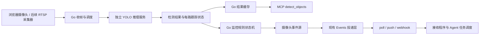
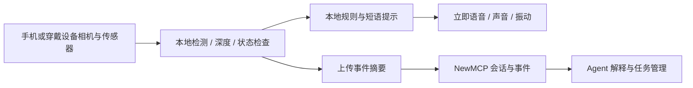

YOLO 摄像头识别与监控可行性调研

调研日期：2026-10-02。依据：当前项目源码与 Ultralytics 官方文档。本文是设计建议；未实现检测服务，未运行模型或进行摄像头、硬件性能实测。文中的工具名、事件名、接口与参数示例均为拟议设计。

完整接入步骤、当前可用工具、拟新增参数、事件订阅与续期约定，以及首版服务端部署方式，见 [摄像头与 Agent 调用指南](./CAMERA-AGENT-CALLING.md)。后续实现与对接应以该调用指南中的约定为准。

可行。当前项目已经具备浏览器取图、最新帧缓存、摄像头虚拟 MCP 工具、实验 Events 与签名 webhook。最合适的增量路径是新增独立 YOLO 推理服务，由 Go 后端负责调度、监控规则、权限与事件投递。单帧识别的接入相对直接；可靠的持续监控还需要采样调整、状态机和后台任务。

兼容性前提：YOLO 作为可选依赖，未配置／未启用或推理服务故障都不能阻断 NewMCP 启动、原 JPEG 推流、capture_frame、基于 VisionConfig 的 analyze_frame 或现有其他功能。旧摄像头默认关闭检测并保留两秒上传间隔，只在后台显式配置后改变；新增能力的错误单独报告，不伪装为未检测到物品。具体迁移与故障隔离要求见调用指南第 5.1 节。

需求应区分三层：

| 需求 | 可行性 | 所需能力与边界 |
| --- | --- | --- |
| 查询画面当前有哪些物品、数量和位置 | 高 | 目标检测；返回类别、置信度、边界框与帧时间 |
| 某类物品出现、消失，进入或离开指定区域 | 高，但需场景验证 | 连续检测、必要时跟踪、区域规则、时间去抖；遮挡和漏检不能直接认定为离开 |
| 指定的某一件物品被拿走、离开后再次返回 | 有条件可行 | 指定初始目标或参考图，结合区域、外观特征或专门训练；跟踪 ID 不能作为永久身份 |

“某类物品不再被检测到”只能表达观测结果，不能单凭这一点断言被拿走、被偷或确实离开了镜头。

当前代码提供了以下接入点：

| 位置 | 已有行为 | 对接建议 |
| --- | --- | --- |
| `web/src/features/cameras/components/use-camera-stream.ts:221` | getUserMedia → canvas → JPEG → WebSocket，每 2000ms 一帧；使用视频原始尺寸 | 上传频率、缩放和质量可配置；增加缓冲检查，防止网络拥塞时累积旧帧 |
| `router/camera_ws.go:91` | 收到 WebSocket 消息后调用 HandleFrame | 保持接收路径轻量；在后台调度检测，避免同步推理阻塞接收 |
| `internal/mcp/camera/stream_manager.go:27` | 每路缓存一张最新帧，时间为服务端收到帧的时间 | 增加 stream epoch、frame sequence 和新帧通知；检测必须检查帧新鲜度 |
| `internal/mcp/virtual/camera_handler.go:29` | capture_frame 返回图像；analyze_frame 调用绑定的视觉模型分析当前帧 | 增加 detect_objects 和监控管理工具 |
| `service/camera.go:247` | 生成摄像头 ToolsCache，并支持启动时同步已有工具 | 同步工具 Schema、配置与前端工具展示 |
| `dto/camera.go:3`、`service/camera.go:55` | 创建摄像头强制绑定 VisionConfig | 如允许纯 YOLO 使用，应调整创建校验，让 YOLO 配置与视觉大模型配置分别选择 |
| `internal/mcp/events/types.go:140` | 事件目录固定为四种 MCP 目录／资源变更；参数仅允许字符串 service、uri | 为摄像头事件定义目录、参数校验和载荷 Schema |
| `internal/mcp/handler/gateway_events.go:110` | 事件源来自上游 MCP 变更通知 | 新增本地摄像头事件源，订阅后台监控产生的业务事件 |
| `internal/mcp/handler/resources_prompts.go:128` | servicesInScope 排除所有 virtual 服务，现有 Events 的授权检查依赖它 | 新增摄像头事件专用权限解析；不能仅加入事件名称，也不能简单移除公共路径过滤 |
| `internal/mcp/events/README.md` | 已有 poll、push、签名 webhook、有限重试、权限复查和内存回放 | 复用投递机制；持续监控需要处理续租、重启和持久化 |

虽然摄像头记录使用 `source_type="webrtc"`，实际实现是浏览器上传离散 JPEG 帧，并没有把连续 WebRTC 视频流交给服务器。FPS 与分辨率字段存在于模型中，但当前 Go 代码没有消费它们来控制浏览器推流。文档里的 RTSP 等来源是产品规划；本次检查到的实际摄像头路径是浏览器推帧。

Ultralytics 的 Detect 模式可以输出多目标边界框、类别和置信度；分类模型只给整张图的类别，不适合作为这里的主要检测模型。标准 COCO 预训练检测模型覆盖 80 类，例如 person、cup、bottle、cell phone、laptop、cat、dog；不是任意物品词典。查询支持哪些类别应读取实际加载模型的 names，而不是写死假设。[Predict 文档](https://docs.ultralytics.com/modes/predict/)、[COCO 文档](https://docs.ultralytics.com/datasets/detect/coco/)。

截至调研时，官方仓库推荐 YOLO26，并仍支持 YOLO11、YOLOv8 等。第一轮建议以 `yolo26n.pt` 为轻量基线，在相同摄像头素材和部署硬件上比较更大的 s 模型。官方 640 输入的 YOLO26n 表格列出 CPU ONNX 约 38.9ms、T4 TensorRT 约 1.7ms；这些是指定测试环境下的基准，不能当作项目端到端时延或多路摄像头容量。项目还要支付采集、编码、网络、解码、跟踪与投递时间。[YOLO26 文档](https://docs.ultralytics.com/models/yolo26/)。

需要指定类别词汇时，可评估 YOLO-World 的 set_classes；需要参考图或视觉提示时，可评估 YOLOE。开放词汇降低了类别限制，但并不保证任意提示都能准确定位，也不提供某件物品的永久身份。固定业务物品、外观相似的多个实例或小目标场景，仍可能需要专门数据与微调。[YOLO-World 文档](https://docs.ultralytics.com/models/yolo-world/)、[YOLOE 文档](https://docs.ultralytics.com/models/yoloe/)。

Ultralytics 已提供 ByteTrack、BoT-SORT 等跟踪器。固定摄像头可以显式选择 ByteTrack 作为初始基线；摄像头移动或遮挡较多时，再评估包含相机运动补偿和外观匹配的方案。连续帧使用 persist=True 维持短期轨迹；每路摄像头须有独立跟踪上下文。帧间隔变大、目标遮挡或离开后返回，都可能导致 ID 变化。track_buffer 以处理帧数表达，必须结合实际处理频率调参，业务规则则更适合按时间表达。[Tracking 文档](https://docs.ultralytics.com/modes/track/)。

推荐的数据流如下：



Go 后端负责摄像头归属、API Key 与分组权限、规则持久化、检测调度、事件生成和 webhook；Python 服务常驻加载模型，处理 JPEG，返回结构化结果，并按 camera ID + stream epoch 隔离跟踪上下文。共享模型推理资源可以节约内存，但帧顺序与 tracker 状态必须分别管理。

采用独立服务的理由是：当前主程序为 Go，Docker 运行镜像使用 Alpine，已有 Python 并不代表已有 PyTorch、OpenCV 与 Ultralytics 推理环境。初版建议给 YOLO 单独使用经过验证的 CPU 或 GPU 镜像，并固定包、镜像与权重版本；Go 通过内部 HTTP 或 gRPC 发送帧。官方提供 CPU、GPU 和 ARM64 部署镜像。[Docker 文档](https://docs.ultralytics.com/guides/docker-quickstart/)。

后续可以导出 ONNX、TensorRT 等格式优化推理。直接将 ONNX Runtime 嵌入 Go 也是一个方向，但仍需要原生运行库、图像预处理、输出解析和跟踪实现，通常需要重新评估当前 CGO_ENABLED=0 的构建与部署方式，初期成本更高。导出格式也不会自动免除模型的许可义务。[Export 文档](https://docs.ultralytics.com/modes/export/)。

每路摄像头最多保留少量待处理帧，过载时优先处理最新帧，并记录丢帧与处理时延；多个工具调用和监控规则共享检测缓存。同一帧只推进一次监控状态，不能因为重复读取缓存而重复累计“连续出现”。WebSocket 接收循环和缓存锁内不运行推理。对一次性识别可临时调度最新帧；对持续监控应使用独立后台任务，不依赖 Agent 不断调用工具。

拟议 MCP 工具：

| 工具 | 用途 | 主要参数 |
| --- | --- | --- |
| detect_objects | 查询当前帧检测结果 | classes、min_confidence、max_age_ms |
| create_monitor | 创建持续监控，返回规则 ID 与初始状态 | label、name、region、event、confirm_ms、absence_ms、cooldown_ms、emit_initial |
| list_monitors | 查询规则、最新状态与健康信息 | 空对象 |
| update_monitor | 启停规则 | monitor_id、enabled |
| delete_monitor | 删除监控任务 | monitor_id |

工具挂在已有 camera_N 虚拟服务时，可由服务绑定摄像头，无需让调用者任意指定 camera_id。目标类别先通过模型类别清单校验；“手机”等中文名称映射为实际类别。特定实例应由用户选定当前框或提供参考图，而不是自动把中文描述当作可靠身份。

detect_objects 的拟议数据示例（对象为 structuredContent 的逻辑内容，同时保留文本 content 以兼容现有客户端）：

```json
{
  "camera_id": 12,
  "stream_epoch": "stream_abc",
  "frame_id": "frame_1842",
  "captured_at": "2026-10-02T09:30:00+08:00",
  "age_ms": 120,
  "cached": true,
  "frame_size": {"width": 640, "height": 480},
  "status": "ready",
  "model": "yolo26n",
  "inference_ms": 45,
  "objects": [
    {
      "class_id": 41,
      "label": "cup",
      "confidence": 0.91,
      "bbox_xyxy": [120, 180, 230, 340],
      "position": "left",
      "track_id": "7"
    }
  ]
}
```

bbox_xyxy 应转换回 frame_size 对应的原始帧像素坐标；stream_epoch、inference_ms 和 track_id 是可选扩展，首版不要求持续跟踪。这里的 captured_at 明确为服务端接收时间，不能伪称设备曝光时间。输入过旧、无帧、摄像头离线与推理失败应返回不同状态／错误，不能一律返回 objects=[]；空数组只表示一张有效且足够新的帧没有匹配目标。

进出监控建议先实现“区域内类别存在／不存在”，再实现跟踪实例的区域穿越。首版 region 为归一化矩形，按目标框中心是否落入区域判断；多边形和框覆盖比例可在后续扩展。出现／消失与空间进入／离开应在规则和事件中分别表达：一件物品在区域内才首次被识别，不等于观察到它跨过区域边界。

例如 Agent 创建规则：“监控桌面区域的 cup，持续未检测到 5 秒时触发 disappeared。”这可以只依赖类别与区域，未必需要精确实例跟踪。建议的状态是 unknown → absent / present，另外记录 pending 与 degraded。启动后先形成基线；初始化时已经存在的物品是否发事件应由 emit_initial 明确控制。

规则应满足以下行为：

1. 只有新鲜且推理成功的新帧可以累积出现／消失证据；阈值同时限制时间和必要的观测数，不能仅依赖墙钟计时。
2. 短暂漏检进入 pending，达到 absence_ms 后才报告“持续未检测到”；恢复检测则撤销 pending。
3. 摄像头断连、持续无新帧或推理失败时转 degraded / unknown，暂停离开判断，并发健康状态事件；不要把离线当成物品消失。
4. cooldown 控制重复通知；只有状态转换才产生业务事件，不按每帧推送物品清单。
5. 重连、更换镜头或服务重启时使用新的 stream epoch，重新形成基线；旧 track_id 不作为跨会话身份。

现有每 2 秒上传一帧约为 0.5 FPS，适合缓慢变化与当前画面查询。在两次采样间完成的进出可能完全漏掉，换更快的模型无法弥补没有采到的画面。建议先用约 640 输入、2–5 FPS 验证桌面物品监控；走动与区域穿越可从 5–10 FPS 开始测试，快速移动再提高采样。以上是实验起点，不是可靠性保证；上传频率、真实采样间隔、处理频率和目标运动速度应一起测量。

浏览器方案需要页面保持运行和设备持续采集。页面关闭、休眠或移动设备后台行为会影响监控。持续值守需要后续 RTSP 拉流或常驻边缘采集器，即使 Agent 已注册规则，也不能凭空获得停止上传的摄像头画面。

事件层建议初版提供 camera.monitor.triggered，载荷携带具体 trigger；另提供 camera.monitor.status_changed 表达离线和恢复。以下是拟议事件数据，不是当前已经可用的 API：

```json
{
  "eventId": "evt_example",
  "name": "camera.monitor.triggered",
  "timestamp": "2026-10-02T09:30:05+08:00",
  "data": {
    "service": "camera_12",
    "camera_id": 12,
    "monitor_id": "mon_abc",
    "trigger": "disappeared",
    "label": "cup",
    "state": "absent",
    "frame_id": "frame_1847",
    "captured_at": "2026-10-02T09:30:05+08:00",
    "last_detected_at": "2026-10-02T09:30:00+08:00",
    "stream_epoch": "stream_abc"
  }
}
```

拟议订阅参数（省略 JSON-RPC 外壳与客户端协议元信息；secret 仅为占位文字）：

```json
{
  "name": "camera.monitor.triggered",
  "arguments": {"service": "camera_12", "monitor_id": "mon_abc"},
  "delivery": {
    "mode": "webhook",
    "url": "https://agent.example.com/hooks/camera",
    "secret": "whsec_<base64-of-random-secret>"
  },
  "ttlMs": 300000
}
```

尽量让订阅 arguments 继续使用字符串 ID，保留现有 canonical JSON 和 cursor 隔离机制。模型类别、区域、数值阈值放在持久化监控规则里。事件源必须连接真实检测状态机；只把事件名称添加到目录不会产生事件。权限必须检查摄像头归属、API Key 的分组与服务范围、规则归属、摄像头和规则启停，并在回放与每次 webhook 重试前重新验证。授权查询应增加专门的 virtual camera 分支，不改变其他资源／提示词路径的职责。

监控规则生命周期与事件订阅生命周期要分开：规则持久保存，启用时后台执行；订阅决定哪些接收者获得通知。当前事件 manager 按身份与参数管理 feed，不应为每个订阅者重复启动 YOLO 推理。它还缺少跨进程重启的业务事件日志，长期部署应由业务层保存事件，并评估与现有 cursor 的回放对接。

当前 webhook 已有 Standard Webhooks HMAC-SHA256、验证 challenge、按 eventId 去重所需的稳定 ID、有限重试和每次投递的权限检查。它要求公网 HTTPS，明确禁止内网地址；本地 Agent 可先用 poll 或 push，不能直接把 localhost URL 填进现有 webhook。接收程序先验签、保存事件并快速应答，再排队执行 Agent。[项目 Events 说明](../internal/mcp/events/README.md)、[项目协议说明](./MCP-PROTOCOL.md#113-webhook-生命周期与验签)。

当前 webhook 订阅最多授予 5 分钟，且订阅与回放都是内存状态，服务重启后需要重建。若复用它，客户端必须按 refreshBefore 自动续期并处理 gap。不能只把 TTL 改长就宣称可靠持续监控。需要重启恢复和离线补发的部署，应增加规则与业务事件持久化、待投递任务及失败记录，再设计订阅恢复。重复投递仍可能发生，接收端按稳定的业务事件 ID 做幂等；不能声称 exactly-once 或永不丢失。

Webhook 或 SSE 只能把事件交给接收程序，不能自动让所有 AI Agent 开始一轮推理。客户端／Agent 平台必须有接收、去重、排队、恢复或启动 Agent 的机制。不支持自定义 events/* 的客户端可以通过普通 MCP 工具创建规则，再由外部接收程序处理 webhook。现有 Events 为项目实验扩展，现代请求要显式声明 io.newmcp/events，不能假定所有 MCP 客户端天然支持。[项目实验扩展说明](./MCP-PROTOCOL.md#112-newmcp-实验-events-范围)。

适合的 Agent 工作流是：读取当前检测结果 → 把用户需求转成具体监控规则 → 注册通知 → 在事件发生后解释并执行用户授权的动作。必要时调用现有 analyze_frame 或对保存的事件帧做语义复核。复核应使用触发时的证据帧；延迟调用 analyze_frame 得到的是最新帧，目标可能早已离开。持续检测由后台完成，大模型用于规则理解和事件处理，可以减少逐帧大模型请求。

事件默认传结构化摘要。需要取证时短期保存受权限保护的 JPEG，载荷给出受控引用；未检测到目标的事件通常需要同时保存 last_seen 帧和确认未检测到的帧。不要在每条 webhook 中塞完整 base64 视频，也不要生成永久公开图片 URL。

实施顺序建议：

| 阶段 | 可交付内容 | 主要验证 |
| --- | --- | --- |
| 1：单帧识别 | 独立推理服务、检测配置、detect_objects、帧新鲜度、可选带框图；解耦强制 VisionConfig 绑定 | 目标类别准确率、原图坐标、空结果与错误区分、同帧复用、CPU/GPU 实际时延 |
| 2：基础监控 | 可配置推帧、后台任务、区域与类别规则、去抖状态机、持久化规则、状态查询 | 实际进入／离开、遮挡、短暂漏检、摄像头掉线、恢复、重复帧、任务删除 |
| 3：事件与 Agent | 摄像头事件目录和源、独立权限解析、复用 poll/push/webhook、接收示例与续期 | 验签和 challenge、重试去重、续期、撤权后停止投递、重启与回放缺口 |
| 4：长期运行与复杂目标 | 业务事件日志和恢复投递、RTSP／边缘采集、特定实例匹配或自定义训练 | 多路容量、长时间运行、快速目标、相似实例、夜间和小目标 |

阶段 1 工程工作相对较小，阶段 2–3 涉及持续任务、事件与权限，复杂度明显更高；阶段 4 依赖采集设备、目标外观和实际数据。没有部署硬件、目标类别和容错目标，不能准确承诺工期、告警延迟或识别率。验证应使用实际机位录像／摄像头，统计误报、漏报、事件延迟的分布和设备资源占用，而不只用官方示例图片证明模型可运行。

许可方面，当前项目 LICENSE 与 README 已声明 AGPLv3；Ultralytics 也提供 AGPL-3.0 与 Enterprise 两种许可路线。按 Ultralytics 官方许可页面，闭源集成、专有 SaaS 等需要评估 Enterprise 授权，代码和模型的许可都要核对。将推理服务拆成独立进程或导出 ONNX 不能当作自动规避许可的办法。项目自身商业授权也不能代替 Ultralytics 的授权；最终许可义务应以所选版本和实际集成方式确认。[Ultralytics 许可说明](https://www.ultralytics.com/license)、[当前项目许可证](../LICENSE)。

建议首个范围限定为：一个固定摄像头、COCO 常见物品、detect_objects、区域内持续出现／消失规则，并通过现有事件投递机制通知。此范围能验证完整链路，并为特定物品身份、长期值守和多路监控提供实测基础。

新增场景评估：盲人／低视力用户寻找物品与障碍提示（2026-10-02）。

可以支持视觉辅助，但寻找物品与行走避障应分别设计。前者适合作为第一版；后者需要本地实时感知、几何信息和针对实际危险的验证。仅接入 MCP 与订阅事件，不会自动获得手机摄像头、语音播报和振动能力，客户端必须实现这些功能，并接入摄像头上传与事件消费流程。

| 场景 | 推荐范围 | 尚需补充 |
| --- | --- | --- |
| 站定后寻找杯子、手机等常见物品 | 第一版可做 | 目标搜索会话、连续位置反馈、语音／振动、相机状态提示 |
| 寻找自己的钥匙、钱包等特定物品 | 后续个性化能力 | 目标登记、多角度参考样本与实例匹配；不能仅依赖通用类别或 track ID |
| 描述前方的人、椅子等已识别物体 | 辅助环境信息 | 区分画面位置与用户实际方位；不把类别存在直接当成碰撞风险 |
| 提醒行走路径附近的障碍 | 在受控环境中研究验证 | 深度、姿态与运动估计、地面／可通行区域、低延迟本地反馈 |
| 户外独立导航、过马路、保证没有障碍 | 超出当前架构和模型已验证能力 | 系统性的危险覆盖、可靠性与实际场景验证；不能根据“未检测到”发出安全通行保证 |

寻找物品可以采用：用户说“帮我找杯子” → Agent 创建搜索会话 → 客户端持续采集 → YOLO 检测 → NewMCP 发 target_found／target_lost 等事件 → 客户端播报“当前画面左侧发现杯子”，并用振动表达目标是否进入画面中心。连续方向反馈由客户端处理，不需要每次都等待大模型生成文本。未校准手机朝向时，提示必须指明“画面左侧”，不能误称“你的左前方”。固定房间摄像头若要给人指路，还需要定位用户并建立摄像头与空间坐标关系。

存在可参考的实际先例：Microsoft Research 的 Find My Things 让用户登记个人物品，再用声音与振动辅助寻找。这证明了交互方向的可行性，不证明当前 YOLO 方案已经具有同等能力。它的设计也包含盲人／低视力用户共同参与，适合参考这种验证方式。[Find My Things](https://www.microsoft.com/en-us/research/story/find-my-things/)。

建议增加 start_assist_session、get_assist_state、stop_assist_session 等会话工具，目标登记可后续增加 register_personal_object。事件可包含 target_found、target_lost、guidance_updated 和 perception_degraded。语音、声音和触觉反馈在客户端执行；NewMCP 负责规则、会话、权限与事件。普通 Agent 客户端如果只支持 tools/call，需要额外的事件接收与持续任务模块。

Detect 模型输出二维框、类别与置信度；它本身不能提供可靠的物理距离或可通行路线。Ultralytics 当前另外提供 YOLO26-depth 单目深度模型，输出估计的米制深度，其官方文档也提供针对相机／场景的尺度校准方式。目标检测与深度是不同任务，通常需要组合使用；输出“米”并不意味着实际机位和所有表面的距离误差已被验证。[Detect](https://docs.ultralytics.com/tasks/detect/)、[Depth](https://docs.ultralytics.com/tasks/depth/)。

可进一步评估支持设备上的 ARKit sceneDepth（LiDAR）或 ARCore Depth API。ARCore 可结合运动估深和可用的 ToF 传感器，深度质量仍受设备、运动与表面特征影响。传感器数据必须与 RGB 帧对齐时间和坐标，并提供深度质量及设备姿态状态。[ARKit sceneDepth](https://developer.apple.com/documentation/arkit/arframe/scenedepth)、[ARCore Depth](https://developers.google.com/ar/develop/depth)。

障碍还包括不能简单列为物品类别的地面落差、台阶、坑洞、细杆和悬空障碍等。透明／反光表面、暗光和运动模糊也应纳入测试。系统需要估计障碍是否与行走路径相关，而不只是某个类别出现在画面中；摄像头视野以外没有观测，低风险类别也可能挡路。不能把 COCO 类别清单或检测置信度当成危险覆盖率。

行走提示建议使用两条路径：



这里的本地感知与事件摘要上传需要新增实现；它们不是当前已有能力。紧迫提示走手机／边缘设备上的短路径，NewMCP 和 Agent 处理会话、目标设定、非紧迫解释与记录。Webhook 适合异步通知，不能作为唯一即时反馈通道；网络断连时，本地规则应继续工作或明确提示感知中断。连接恢复后，历史事件不得重放成当前行走指令。

当前每 2 秒采一帧，假设用户每秒走 1 米，仅采样间隔就可能让用户在两帧间移动 2 米，尚未计算上传、推理、投递、播报和人的反应时间。因此不能用当前采样频率加云端 Agent 响应承担即时避障。应按实际速度、可观测距离和反应时间确定时延预算，测量从设备采集到反馈开始的 p95／p99 时延与丢帧，不能只测模型 FPS。

事件载荷宜包含 session_id、frame_id、source_timestamp、expires_at、direction_frame、target、distance_m、distance_source 和感知状态；没有验证距离时 distance_m 为 null。客户端以时间期限丢弃旧反馈，在设备时间与服务端时间不能直接比较时还要处理时钟偏差。低光、镜头遮挡、无新帧或推理异常应发“感知受限／暂停”的状态提示，不能静默表现为“没有障碍”。当前帧包只有 JPEG 与接收时间，这些元信息需要扩展采集协议。

无障碍交互应允许语音启动／停止、屏幕阅读器操作和明确的摄像头状态提示；提示可打断、去重并限制播报频率，紧迫信息优先，避免语音淹没周围环境声音。振动模式需由用户选择并验证其可辨识性。是否使用浏览器或原生客户端还取决于设备锁屏、后台采集、离线推理及触觉支持，行走原型更适合原生手机／穿戴客户端。

第一版建议限定为“用户站定、缓慢转动手机寻找常见物品”，先完成从语音请求到目标发现和方向反馈的闭环；随后增加个人物品登记，再单独验证障碍辅助提醒。产品定位应为辅助环境感知，不能代替白杖或导盲犬，也不能承诺无人陪同导航。Apple 对其检测模式同样明确限制导航和高风险使用，这是该场景的实际可靠性边界。[Apple 检测模式说明](https://support.apple.com/zh-cn/guide/iphone/iph35c335575/ios)。

本次新增评估仅完成资料与架构分析，没有实现或验证盲人辅助客户端。需要邀请目标用户参与可控环境中的交互验证，分别统计寻物成功率、特定实例误认、障碍漏报／误报、帧新鲜度与端到端反馈延迟。
